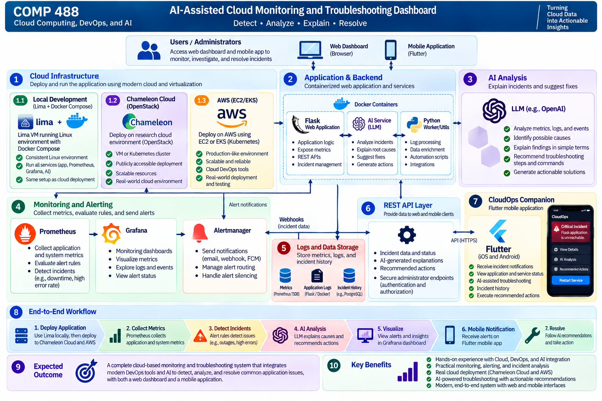

# Intermediate Project Report

## AI-Assisted Cloud Monitoring and Troubleshooting Dashboard

**Student:** Khalidou Bass

**Course:** COMP 488 – Cloud Computing, DevOps, and AI

**Instructor:** Gregor von Laszewski

**Date:** October 2026
**Status:** In Progress – Monitoring, Rule-Based Troubleshooting, and Hybrid AI Integration Implemented

## 1. Project Overview

The goal of this project is to develop an **AI-Assisted Cloud Monitoring and Troubleshooting Dashboard** that monitors a containerized web application, detects common operational issues, and uses artificial intelligence (AI) to explain possible causes and recommend troubleshooting actions.

The project combines cloud computing, DevOps, monitoring, containerization, automation, and AI into a practical system for understanding and responding to application incidents.

As an extension, the project will explore **CloudOps Companion**, a cross-platform mobile application developed using Flutter. This application will allow administrators to receive incident notifications, monitor application health, and access AI-assisted troubleshooting recommendations remotely.

The primary objective remains to build a reliable end-to-end cloud monitoring and troubleshooting prototype.

## 2. System Overview and Implementation

The system follows a phased implementation approach. The core monitoring pipeline, incident API, rule-based troubleshooting, and optional LLM integration are implemented. Local monitoring and performance evaluations have been conducted; live LLM evaluation and cloud deployment remain planned:

1. **Application Deployment:** Deploy a containerized Python/Flask web application locally and to selected cloud environments.
2. **Monitoring and Metrics Collection:** Collect application performance metrics, availability information, and relevant operational data.
3. **Incident Detection:** Detect selected incidents, including application outages, elevated HTTP error rates, and resource-related problems.
4. **AI-Assisted Analysis:** Use an AI component to interpret monitoring information, explain possible causes, and recommend troubleshooting actions.
5. **Web Dashboard:** Visualize application health, monitoring metrics, detected incidents, and troubleshooting information.
6. **Mobile Incident Monitoring:** Extend the system through a Flutter mobile application for remote incident notifications and monitoring.
7. **Administrator-Approved Remediation (Optional):** Explore secure, predefined corrective actions that administrators can explicitly approve.

### Target System Architecture

The target architecture consists of:

- **Application Layer:** A containerized Flask application exposing health information and monitoring metrics.
- **Monitoring Layer:** Prometheus for metrics collection and alert evaluation.
- **Visualization Layer:** Grafana for monitoring dashboards and performance visualization.
- **Troubleshooting Layer:** Implemented rule-based and optional LLM-assisted incident analysis, supporting OpenAI and Ollama with caching, inference limits, and automatic fallback.
- **Backend API Layer:** Flask-based REST APIs for providing incident information to client applications.
- **Mobile Layer:** CloudOps Companion, a Flutter application for remote monitoring and notifications.
- **Cloud Infrastructure Layer:** Local Docker deployment and selected cloud environments for deployment and evaluation.

The mobile application will communicate with the backend through authenticated APIs rather than accessing infrastructure management interfaces directly.

## 3. Technologies

The project is expected to use:

| Technology | Purpose |
|---|---|
| **Python / Flask** | Web application, backend services, and REST APIs |
| **Docker / Docker Compose** | Containerization and local service orchestration |
| **OrbStack** | Optional alternative to Docker Desktop for evaluation |
| **Chameleon Cloud / OpenStack** | Planned research-cloud deployment |
| **AWS** | Planned public-cloud deployment and comparison |
| **Prometheus** | Metrics collection, monitoring, and incident detection |
| **Grafana** | Monitoring dashboards and visualization |
| **LLM / AI Integration** | Incident analysis and troubleshooting recommendations |
| **Flutter / Dart** | Cross-platform mobile companion application |
| **Firebase Cloud Messaging** | Planned mobile push notification delivery |
| **GitHub / GitHub Actions / Makefile** | Version control, automation, testing, and deployment workflows |

The AI integration currently supports OpenAI and Ollama. Live model evaluation, final cloud deployment environments, and the mobile notification mechanism remain subject to project requirements, available resources, and implementation feasibility.

## 4. Project Objectives

The main objectives are to:

1. Develop and containerize a sample web application.
2. Deploy and monitor the application locally and in selected cloud environments.
3. Collect and visualize application health and performance metrics.
4. Detect selected operational incidents using monitoring rules.
5. Integrate AI to explain incidents and recommend troubleshooting actions.
6. Evaluate monitoring behavior, failure-detection latency, and incident-analysis performance.
7. Demonstrate an end-to-end monitoring and troubleshooting workflow.

### Extended Objectives

Subject to available development time:

1. Develop a Flutter mobile companion application.
2. Deliver incident notifications to administrators.
3. Display application health, active alerts, and incident history on mobile devices.
4. Present AI-generated troubleshooting recommendations through the mobile interface.
5. Explore secure, administrator-approved corrective actions for selected incidents.

## 5. Expected Outcomes and Deliverables

The expected outcome is a working prototype demonstrating how cloud monitoring and AI can work together to identify, analyze, and troubleshoot common application issues.

### Core Deliverables

- A functional containerized Flask application.
- Local and selected cloud deployment configurations.
- Prometheus-based metrics collection and alerting.
- Grafana monitoring dashboards.
- Detection and simulation of selected application incidents.
- AI-generated incident explanations and troubleshooting recommendations.
- Monitoring evaluation, including alert validation and timing measurements.
- Recorded experimental results for comparing monitoring and troubleshooting performance.
- Source code, documentation, and a final project demonstration.

The primary workflow will be:

**Application → Monitoring → Incident Detection → AI Analysis → Troubleshooting Recommendation**

### Extended Deliverable: CloudOps Companion

The project will explore a Flutter-based mobile prototype with the following capabilities:

- View monitored applications and their operational status.
- Receive notifications when incidents are detected.
- Review incident details and AI-assisted troubleshooting recommendations.
- Access incident history and resolution status.

An advanced demonstration may include an authenticated administrator approving a predefined remediation action, such as restarting a stopped application service.

The mobile application will complement the web dashboard rather than replace it.

## 6. Project Scope

The primary goal is to complete a reliable end-to-end prototype rather than develop a production-scale monitoring platform.

### Core Scope

The implementation will focus on:

- Containerized application deployment.
- Application and system monitoring.
- Monitoring dashboards and visualizations.
- Incident detection and alerting.
- AI-assisted incident explanation.
- Troubleshooting recommendations.
- Basic automation, performance evaluation, and documentation.
- Security considerations for logs, incident data, and local versus hosted LLMs.

### Extended Scope: CloudOps Companion

Subject to available development time, the Flutter mobile application will focus on:

- Application and service status monitoring.
- Incident notifications.
- AI-generated incident explanations.
- Troubleshooting recommendations.
- Incident history and resolution tracking.

If time permits, the project may demonstrate administrator-approved remediation through a secure backend API.

Any remediation functionality will require authenticated access, explicitly permitted operations, administrator confirmation, and action logging.

AI-generated recommendations will not be executed automatically without appropriate authorization and safeguards.

Advanced features such as comprehensive cloud resource management, autonomous remediation, and production-scale incident orchestration are outside the initial scope.

## 7. Development Timeline

The project will be developed incrementally during the remainder of the semester.

| Phase | Activities |
|---|---|
| **Phase 1: Application Development** | Develop and containerize the Flask application |
| **Phase 2: Monitoring and Visualization** | Integrate Prometheus and Grafana |
| **Phase 3: Incident Detection** | Validate alert firing and incident detection; incident API and rule-based troubleshooting implemented |
| **Phase 4: Performance Evaluation** | Measure detection latency, alert timing, and API response times; record experimental results |
| **Phase 5: Secure AI-Assisted Troubleshooting** | Hybrid OpenAI/Ollama integration, caching, inference budgeting, and fallback implemented; live inference, privacy review, and recommendation evaluation pending |
| **Phase 6: Cloud Deployment and Evaluation** | Deploy the monitoring system to at least one cloud environment (Chameleon Cloud/OpenStack or AWS), validate its operation, and evaluate deployment characteristics; Lima is not required |
| **Phase 7: Optional Mobile Extension** | Develop a Flutter prototype for incident notifications and remote monitoring, subject to time |
| **Phase 8: Integration and Demonstration** | Complete testing, documentation, performance evaluation, and the final demonstration |

The core monitoring and AI-assisted troubleshooting functionality will take priority. The mobile extension will be developed incrementally without compromising the primary project objectives.

## 8. Monitoring and Alert Validation

The monitoring system was tested locally using Docker Compose, Prometheus, and a containerized Flask application. Two controlled experiments validated incident detection and alert recovery.

### 8.1 Application Downtime

The Flask container was stopped while Prometheus and Grafana remained running.

- **Alert:** `ApplicationDown`
- **Condition:** `up{job="flask-app"} == 0` for 15 seconds
- **Observed behavior:** Prometheus reported the alert as `pending`, then `firing`.
- **Recovery:** After restarting Flask, Prometheus cleared the alert.
- **Result:** Detection and recovery verified.

### 8.2 High HTTP Error Rate

A temporary, loopback-restricted endpoint generated HTTP 500 responses inside the Flask container. Error simulation was enabled only for the experiment.

- **Alert:** `HighErrorRate`
- **Condition:** More than 5% HTTP 5xx responses over a one-minute rate window, sustained for 30 seconds
- **Requests generated:** 481
- **HTTP 500 responses:** 481
- **Test duration:** 100.2 seconds
- **Observed Prometheus error ratio:** Approximately 93.68%
- **Observed alert state:** `firing`
- **Recovery:** After restoring the normal container configuration, Prometheus reported no active alerts.
- **Result:** Detection and recovery verified.

The simulation endpoint was confirmed to return HTTP 404 after the experiment, including for requests originating inside the container.

### 8.3 Automated Testing

An earlier test run completed with **11 tests passed**. The latest verified run on October 24, 2026 completed with **138 tests passed** and no failures.

### 8.4 Alert Detection and Recovery Latency

Three controlled trials measured how quickly Prometheus detected application downtime and cleared the `ApplicationDown` alert after Flask restarted.

The experiment stopped the Flask container using Docker Compose, polled the Prometheus rules API every 0.5 seconds, and restarted the application after observing the alert in the `firing` state.

Prometheus was configured with a 5-second scrape interval, a 5-second evaluation interval, and a 15-second alert duration.

| Metric | Trial 1 | Trial 2 | Trial 3 |
|---|---:|---:|---:|
| Detection latency | 26.171 s | 24.147 s | 23.657 s |
| Recovery latency | 9.795 s | 9.275 s | 9.787 s |
| Detection from shutdown initiation | 29.545 s | 27.504 s | 27.101 s |

Across the three trials:

- **Mean detection latency:** 24.658 seconds
- **Mean recovery latency:** 9.619 seconds
- **Detection latency range:** 23.657–26.171 seconds
- **Recovery latency range:** 9.275–9.795 seconds

All three experiments completed successfully. Following the third trial, the Flask application returned HTTP 200, and Prometheus reported the alert as inactive and healthy.

These measurements represent client-observed alert transitions. Detection was measured from completion of the Docker stop command, while recovery was measured from completion of the Docker start command. They do not represent exact internal Prometheus event timestamps.

The experiment implementation, methodology, and results are documented in `benchmarks/alert_latency/README.md`.

### 8.5 Limitations and Next Steps

The experiments validate alert firing, resolution, and client-observed detection and recovery latency in the local environment. However, only three latency trials were conducted, and exact internal Prometheus transition times and notification delivery latency remain unmeasured.

API response times and workload performance have been evaluated separately in Section 9.

Future evaluation will include additional alert latency trials, cloud deployment comparisons, and live LLM-assisted troubleshooting experiments. The current implementation supports rule-based and optional AI-assisted analysis, but successful live inference and diagnostic quality have not yet been established.

## 9. Performance Evaluation

The containerized Flask application was benchmarked locally to evaluate
HTTP response latency, throughput, and reliability under different workloads.

A reusable Python benchmarking script was developed to send sequential
and concurrent requests to the `/health` endpoint and record response times.

### 9.1 Baseline and Concurrent Load Testing

| Metric | Sequential Baseline | Concurrent Baseline | Larger Load |
|---|---:|---:|---:|
| Requests | 100 | 100 | 1,000 |
| Concurrent workers | 1 | 10 | 10 |
| Successful requests | 100 | 100 | 1,000 |
| Failed requests | 0 | 0 | 0 |
| Average latency | 3.35 ms | 9.95 ms | 7.47 ms |
| P95 latency | 5.29 ms | 34.77 ms | 10.28 ms |
| Throughput | 297.26 req/s | 969.02 req/s | 1,330.52 req/s |

Concurrent requests increased observed throughput compared with the
sequential baseline, although individual response times also increased.

### 9.2 Sustained Load Testing

A longer experiment repeatedly executed batches of 1,000 HTTP requests
using 10 concurrent workers for approximately 31 seconds.

| Metric | Result |
|---|---:|
| Duration | 31.00 seconds |
| Total requests | 29,000 |
| Successful requests | 29,000 |
| Failed requests | 0 |
| Overall throughput | 935.61 req/s |
| Average latency | 9.75 ms |
| Median latency | 7.88 ms |
| P95 latency | 17.61 ms |
| P99 latency | 26.67 ms |
| Maximum latency | 46.90 ms |

All 29,000 requests completed successfully during the experiment.

The sustained throughput was lower than the throughput measured during
the shorter 1,000-request experiment, demonstrating the importance of
evaluating performance over different test durations.

### 9.3 Limitations and Future Evaluation

These results were obtained using the Flask development server in a
local Docker Compose environment. The benchmark targeted a lightweight
health-check endpoint rather than computationally intensive application
functionality.

The sustained experiment used repeated short batches rather than one
uninterrupted workload. Consequently, these measurements should not
be interpreted as production capacity guarantees.

Future work will include longer continuous tests, resource utilization
measurements, cloud deployment comparisons, and evaluation using a
production WSGI server.

The reusable benchmarking script, detailed methodology, and complete
results summary are documented in `benchmarks/README.md`.

## 10. Implementation Progress — October 2026

### 10.1 Web Dashboard and Application Management

The Flask application now includes a web dashboard for monitoring and administration. Implemented functionality includes:

- Administrator authentication and session management.
- Application registration and persistent storage using SQLite.
- Validation of application endpoints and registration inputs.
- Prometheus file-based service discovery for registered monitoring targets.
- Incident information and troubleshooting guidance through the backend API.

### 10.2 Hybrid AI-Assisted Troubleshooting

The backend implements hybrid incident analysis using rule-based troubleshooting and optional LLM-generated recommendations.

Supported AI integrations include:

- OpenAI through its hosted chat-completions API.
- Ollama through a restricted local endpoint.
- Structured responses containing an explanation, possible causes, and recommended actions.
- Automatic rule-based fallback when AI is disabled, unavailable, or returns invalid output.

AI-assisted analysis is disabled by default and requires explicit configuration.

### 10.3 Reliability and Security Safeguards

Implemented safeguards include:

- Restricting AI requests to selected incident fields.
- Restricting supported AI service endpoints.
- Treating incident details as untrusted input in the model instructions.
- Read-only troubleshooting recommendations without automatic remediation.
- An in-memory diagnosis cache configured for 900 seconds and 100 entries.
- An in-memory inference budget configured for 10 requests per 60 seconds.
- Synchronization to reduce duplicate inference for concurrent requests.

These controls reduce operational risks but do not eliminate risks such as sensitive information appearing within incident descriptions or prompt-injection attempts.

### 10.4 Automated Testing and Packaging

On October 24, 2026, the project was verified using:

- `make install`: successful editable installation of `kbass-monitoring==0.1.0`.
- `make test`: **138 tests passed in 0.41 seconds**.

The test suite covers application management, authentication, monitoring discovery, incident handling, AI client behavior, hybrid troubleshooting, caching, inference budgeting, and validation.

AI client and incident integration tests use mocked provider responses. Consequently, these passing tests do not establish successful live inference against OpenAI or Ollama.

### 10.5 Remaining Evaluation Work

The next development and evaluation activities include:

1. Verify live inference with a configured LLM.
2. Measure LLM response latency and evaluate diagnostic usefulness.
3. Document pull-based monitoring limitations and possible event-driven alternatives.
4. Review safeguards for sensitive incident descriptions and externally hosted models.
5. Evaluate cloud deployment and additional monitoring benchmarks as time permits.
6. Consider optional OrbStack and mobile application experiments only after core objectives are satisfied.

## 11. Conclusion

This project aims to demonstrate how cloud computing, DevOps monitoring, and AI-assisted troubleshooting can be integrated into a practical system for detecting and understanding application incidents.

By combining a containerized application, Prometheus, Grafana, cloud infrastructure, and AI-generated recommendations, the project will provide an end-to-end demonstration of application monitoring and incident response.

The planned **CloudOps Companion** extension will further explore how administrators can receive notifications and respond to operational issues remotely through a Flutter mobile application.

Together, these components will illustrate a practical approach to improving cloud application visibility, incident understanding, and operational responsiveness.
